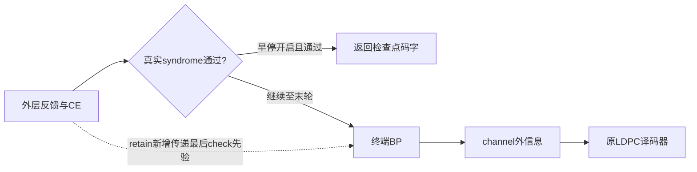

# Terminal check-prior matched reference

Static kernel inspection establishes three coupled legacy/finite differences: prior initialization, Gaussian versus finite variable messages, and default edge projection temperature. `return_soft` with explicit code_prior returns finite posterior moments containing that prior; it cannot be passed to the Gaussian demapper as channel likelihood.

Reuse terminal_decode(code_prior=...). None preserves every legacy default. Explicit circular BP prior must be real finite I-then-Q length2N, amplitude .5. Reject booleans, noncircular/pseudo/cavity/convergence combinations for this new route. Set default terminal projection temperature2, matching existing terminal finite-zero control; an explicit bp_temperature remains honored. Use the kernel's channel_llr message (own prior excluded), clip20, then common LDPC50. Record delivered prior and finite posterior moments; do not label them Gaussian statistics. Existing SISO and noncircular-zero semantics remain unchanged.

Matched terminal arms: LEGACY (unchanged None), ZERO (explicit allzero,temperature2), RETAIN (last actual decoder prior_after,temperature2), plus RETAIN_REPEAT for engineering. Compare RETAIN versus ZERO to isolate prior effects on the finite-message branch; comparisons with LEGACY also include the branch change and cannot alone establish a pure prior effect. Hold H, pilot-cancelled y, sigma, BP20/damping.5/threshold1e-4, code and inputs fixed. This is a cached terminal counterfactual, not a complete new receiver.

After real small-code qualification, engineering uses two existing blocks×7/8dB×four arms=16T, one CPU thread, 600seconds,2GiB. Require LEGACY exact frozen output and RETAIN repeat exact, actual BP/LDPC calls, input/prior/output hashes, raw decoder replay. Subsequent development, only after engineering rawPASS, uses all32 existing blocks×7/8×three arms=192T,900seconds,4GiB. No new random inputs or CONF; no cherry-picking the three failure blocks. Full chain integration follows only if this controlled comparison supports it. Ordinary retained feedback is not novelty.

## Full receiver admission after the 192T result

The fixed terminal comparison passed raw audit and found 4/32 versus8/32 at7dB (exploratory p=.125). Extend the existing stop runner, using a distinct `trans-retained-stop-v1` contract rather than changing old contracts. Engineering: two prior blocks×7/8dB×BP_REF47/BP_RETAIN/BP_RETAIN_STOP/BP_RETAIN_STOP_REPEAT=16F;600seconds,4GiB,oneCPUthread. Development, only after rawPASS:32 existing blocks×7/8dB×BP_RETAIN/BP_RETAIN_STOP=128F;900seconds,8GiB. No new random inputs.

BP_RETAIN must preserve every outer state and exactly match the already audited retained-terminal counterfactual on the same final H/noise/prior. Compare BP_RETAIN_STOP to that full reference for actual prefix and first valid syndrome; no terminal executes after stop. Default BP_REF47 must exactly match original outputs. All terminal/nested LDPC, actual CE/operator counts, raw finite prior/APP semantics and repeat states are audited. Existing stop contracts keep their original validation and recovery boundary.

