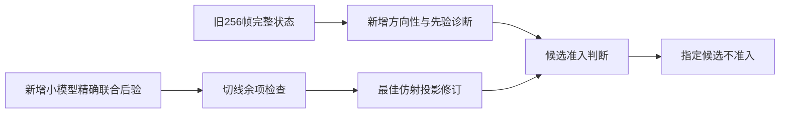

# 施工交工单：AFDM 主推断因果验证

独立性：由未参与实现的新代理独立复算原始证据；运行时未提供可核验的模型标识，采用继承主会话模型。日期：2026-10-03。

本轮执行《AFDM 主推断数学缺陷与因果验证任务书》：五个问题、两个推导要求均已形成结果或明确的条件性关闭判定。数学诊断和一次最优仿射修订完成；候选未通过模型准入，因此主检测器与后续性能实验按计划降级为不开展。**没有得到新的同预算性能优势，也没有证明整个方向已无创新空间。**

## 目标对账

| 任务书目标 | 状态 | 得到什么 |
|---|---|---|
| 统一统计模型与先验作用 | 完成诊断 | CE与joint先验尺度不同，但初始化差异在固定接口大多被joint吸收；不能称主要bug。 |
| 标量信息损失与实际关联 | 完成诊断，因果证据不足 | 方向表达缺口成立；256帧、6失败的关联受末级分支混杂，不能解释FER。 |
| 耦合与软信息过度自信 | 完成小模型检验 | 48条件精确后验对照不支持joint普遍过度自信；point控制反而明显更差。 |
| 修复是否恢复正确数学行为 | 数学参照完成，候选未准入 | Schur完整协方差/退化极限检查通过；最佳仿射修订仍仅1/24有导频条件满足余项门。 |
| 同预算实际价值与独立确认 | 条件性关闭，未运行 | 没有合格的新主检测器，故不以堆计算开展FER比较；没有性能通过结论。 |
| 合法外信息 | 推导与局部检验完成 | 必须从存储因子中扣除自身信息；不能把同y后验当独立先验。完整新接收闭环未实现。 |
| 双线性余项 | 小模型完成，生产失败帧未验证 | 计算余项均值、能量、交叉项并求最佳仿射下界；N1024真实失败帧的联合后验未知。 |

## 本轮新增内容与关键决策

新增独立诊断包experiments/afdm_inference_causal_20261002：真实源码已知数据极限、全队列状态分析、仅先验干预、精确离散/高斯联合后验、Schur参照、余项与最优仿射投影。原接收机、旧结果和论文未修改。



先验干预实际运行1024次固定接口scalar调用；20步后初始增益差中位保留1.064%，40步保留0.047%。这里只观察扰动传播，不是新增完整级联FER。小模型另有192次真实scalar调用；有导频pilot-ridge初始化下概率误差为joint .006657、point .042395。保留现有增益不确定性本身有作用。

最优仿射投影使用全部实虚部和精确后验，把残差与状态正交化。它比普通切线更好，但有导频残差能量平均仍为噪声的.339428倍；预设门是.1倍，24条件仅1个通过。全部正特征模态保留，结果不是截断伪影。正交并不等于独立，不能将残差直接当作消失。

文献原文核对确认：双线性方差乘积、cavity和EP/EC均有既有方法；当前joint已经包含P·vh·vx。这轮不能将标准代数或更多检测轮数包装为创新。

## 验证情况

36项针对性数学/接口测试通过。独立复核检查214项哈希，另用条件高斯求积与最小二乘重算48个条件，最大误差3.22e-15，结论一致；全过程实际单线程。小模型仅6个外生随机簇，不作总体显著性声明。没有新完整级联、GPU或独立FER确认；SSH仅作可达性检查。

## 留给后续的边界与复现入口

本CSV没有待用户解除的执行阻塞。指定的“单一全局仿射且忽略残差”候选已按工程门关闭。显式余项建模、模式条件化、非线性推断仍未验证，不能据本轮宣称无效或有效；新的候选需要自己的消息、复杂度与适用性证据。

从项目根执行以下命令可复核10项包内测试（含源码条件诊断，不是FER）：

```sh
PYTHONDONTWRITEBYTECODE=1 OPENBLAS_NUM_THREADS=1 OMP_NUM_THREADS=1 MKL_NUM_THREADS=1 VECLIB_MAXIMUM_THREADS=1 NUMEXPR_NUM_THREADS=1 .mission/20261001_23-33-35-afdm-innovation-space/scratch/venv/bin/python -m unittest discover -s experiments/afdm_inference_causal_20261002/tests
```

其余26项测试在根tests/test_exact_oracle.py、test_oracle_comparison.py、test_remainder_diagnostics.py、test_slr_diagnostics.py。各诊断文档提供运行说明；原始结果已存在时脚本拒绝覆盖，应直接读取本任务execution/下的注册、结果与raw。详细结果入口是experiments/afdm_inference_causal_20261002/FINDINGS.md。正式复核使用controls/thread_binding.py检验实际BLAS线程，而不只设置环境变量。
