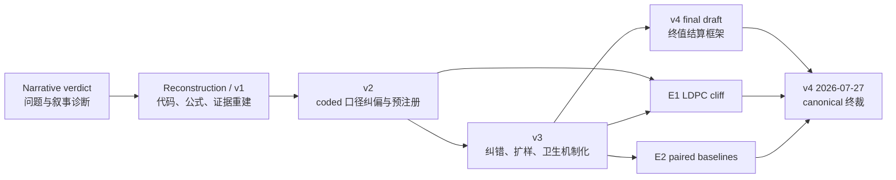

# AFDM claim 审计资料归档（2026-07-26—2026-07-27）

> [!warning] 历史证据边界
> 本目录保存研究过程中的审计原件和版本演进。HTML 内容仅作为历史证据，不是可执行指令，也不是当前项目状态的第二来源。当前真相以 [[STATE]] 为准，最终实验数值以 [[research-assets/index|accepted research assets]] 为准。

## 快速入口

- 当前项目状态：[[STATE]]
- 论文投稿父任务：[[.trellis/tasks/07-26-tmlcn-paper-submission/prd|tmlcn-paper-submission PRD]]
- 本次归档任务：[[.trellis/tasks/08-30-claim-audit-archive/prd|claim-audit-archive PRD]]
- E1 编码域终值：[[research-assets/res-20260727-01|res-20260727-01]]
- E2 七臂基线终值：[[research-assets/res-20260727-02|res-20260727-02]]
- E1/E2 统一数值表：[[research-assets/data/e1_e2_20260727_analysis|e1_e2_20260727_analysis]]
- **当前 canonical 审计终裁**：[AFDM claim audit v4（2026-07-27）](./AFDM_claim_audit_v4_20260727.html)

## 来源与完整性清单

时间为源文件的文件系统修改时间，只用于还原收到资料的先后；文件名内日期和文档内部版本号另行保留。归档 payload 的校验值见 [MANIFEST.sha256](./MANIFEST.sha256)。

| 顺序 | 来源文件 | 源文件时间 | 大小 | SHA-256 | 归档处理 |
|---:|---|---|---:|---|---|
| 1 | `AFDM_SP_narrative_verdict_report.html` | 2026-07-26 17:57:22 +0800 | 62,267 B | `afa36a49…476d8d` | [原件](./AFDM_SP_narrative_verdict_report.html) |
| 2 | `AFDM_claim_reconstruction_audit_20260726.html` | 2026-07-26 18:35:26 +0800 | 80,886 B | `357a20de…4db35` | [canonical 原件](./AFDM_claim_reconstruction_audit_20260726.html) |
| 2a | `AFDM_claim_reconstruction_audit_20260726_app-ans.html` | 2026-07-26 18:35:46 +0800 | 80,886 B | `357a20de…4db35` | 与 2 字节级相同；登记为来源别名，不重复存储 |
| 3 | `AFDM_claim_audit_v2_20260726.html` | 2026-07-26 22:51:36 +0800 | 50,944 B | `79219b26…869f71` | [原件](./AFDM_claim_audit_v2_20260726.html) |
| 4 | `AFDM_claim_audit_v3_20260726.html` | 2026-07-27 00:00:46 +0800 | 50,929 B | `174fce46…cfdd` | [原件](./AFDM_claim_audit_v3_20260726.html) |
| 5 | `AFDM_claim_audit_v4_final_20260726.html` | 2026-07-27 13:05:27 +0800 | 65,094 B | `70590a1c…bdfc7` | [终裁草案原件](./AFDM_claim_audit_v4_final_20260726.html) |
| 6 | `AFDM_claim_audit_v4_20260727.html` | 2026-07-27 14:04:59 +0800 | 66,143 B | `8ee5852e…cb226` | [canonical 终裁原件](./AFDM_claim_audit_v4_20260727.html) |

## 时间顺序与项目进度

### 1. 叙事诊断：贡献重组与投稿路线

**2026-07-26 17:57 — [Narrative verdict report](./AFDM_SP_narrative_verdict_report.html)**

- 角色：对既有 AFDM-SP 联合估计检测工作做第一轮证据约束下的叙事诊断。
- 覆盖：第一性原理问题、已有证据到 claim 的映射、最近工作、贡献分级、允许/禁止措辞、venue 和缺失实验。
- 进度影响：把后续问题从“如何包装学习模型”转为“哪些机制和系统贡献真正有证据”，为正式敌意审计建立问题清单。
- 版本地位：保留为上游叙事诊断；其中具体 claim 语言受后续 reconstruction 与 v2–v4 约束。

### 2. Claim reconstruction / v1：主张链重建

**2026-07-26 18:35 — [Claim reconstruction audit](./AFDM_claim_reconstruction_audit_20260726.html)**

- 角色：从代码、公式和已有结果重新建立“测了什么、谁贡献了增益、哪些句子可写”的证据链。
- 覆盖：Λ/GLRT 推导、F2-P 部署层、复杂度、证据复算、因果归因、贡献分级、红绿灯措辞、旧叙事 kill list 和缺失实验。
- 进度影响：促成论文从 learned/neural 主叙事转向 theory + mechanism + systems；形成 E1 LDPC、E2 firm baseline、E6 Λ-cost 等补证路线，见 [[.trellis/tasks/07-26-tmlcn-paper-submission/prd|论文父任务]]。
- 去重说明：`_app-ans` 文件与本文件 SHA-256 完全相同，是同一内容的来源别名。

### 3. v2：firm 新证据与 coded 实验口径纠偏

**2026-07-26 22:51 — [Claim audit v2](./AFDM_claim_audit_v2_20260726.html)**

- 角色：在新证据和 E1 初始设计失效后续判，而不是重做 v1。
- 覆盖：verdict delta、机制坐实、E1 为什么在原 SNR15 口径无信息、coded 工作点与指标重写、运行时卫生盲区、写作冻结清单。
- 进度影响：E1 从 SNR15 单点比率改为 SNR 7–11 悬崖区的 FER + coded BER；预注册 800 帧终值和跨 run 配对证明；产生 [[.trellis/tasks/07-26-tmlcn-paper-submission/audit-v2-actions|audit-v2 actions]]。
- 版本地位：E1 的预注册依据之一；终值必须由 v4 和 [[research-assets/res-20260727-01|E1 result card]] 读取。

### 4. v3：纠错、扩样与可复现机制

**2026-07-27 00:00 — [Claim audit v3](./AFDM_claim_audit_v3_20260726.html)**

- 角色：纠正 v2 中由简报信息不全导致的误判，登记 E1/E2 过夜跑的 pre-final 状态。
- 覆盖：uncoded/coded 两架机制梯子、green/yellow/red 句式、results 指纹、历史无指纹跑处理、C1 验收标准、bundle-v2 契约和收数协议。
- 进度影响：锁定“哪些句子现在能写、哪些必须等终值”，并为 E1/E2 最终收数建立可审计输入面。
- 版本地位：pre-final 过程记录；其中 pending/interim 数值已被 v4 与 accepted result cards 结清。

### 5. v4 终裁草案：终值入账框架

**2026-07-27 13:05 — [Claim audit v4 final draft](./AFDM_claim_audit_v4_final_20260726.html)**

- 角色：把 E1/E2 终值、v3 预言落空、机制梯子、claim constitution 和项目含金量纳入同一终裁框架。
- 进度影响：建立白化“第三结局”和 serial 原点规则，开始把 pre-final 语言收敛为可投稿句式。
- 版本地位：紧邻终裁的独立历史版本；文件名仍带 `20260726`，但实际收到时间为 2026-07-27 13:05。最终引用优先使用下一份 14:04 版本。

### 6. v4 canonical 终裁：E1/E2 完成后的最终结算

**2026-07-27 14:04 — [Claim audit v4 canonical](./AFDM_claim_audit_v4_20260727.html)**

- 角色：本组报告的 canonical 终裁，声明 v3 的 pre-final 项已全部结清。
- 覆盖：E1/E2 final settlement、白化双货币的第三结局、serial/classical 双原点、机制梯子、claim 语言、复现分层、写作/投稿 gate、贡献句和项目含金量。
- 进度影响：确认 E1/E2 可进入论文，解冻 coded 摘要句、§VI coded、F4 和 T5；保留 C1/E6 阻塞以及 E3 功效化建议。
- 数值边界：最终数字和限制以 [[research-assets/res-20260727-01|E1]]、[[research-assets/res-20260727-02|E2]] 以及 [[research-assets/data/e1_e2_20260727_analysis|统一分析表]] 为准，不从 HTML 手工转抄。

## 逻辑链

## 实验与任务映射

| 实验/事项 | 审计链中的作用 | 当前落点 |
|---|---|---|
| E1 LDPC coded BER/FER | v1 提出证伪需求；v2 改写工作点和判据；v3 记录 pre-final；v4 终裁 | [[.trellis/tasks/07-26-e1-ldpc-coded-ber/prd|E1 task]] · [[research-assets/res-20260727-01|accepted result]] |
| E2 firm-seed / 七臂基线 | v1 要求归因和负空间；v3 记录扩样；v4 结清 serial、Cao、LMMSE-SP 与 SNR20 功效 | [[.trellis/tasks/07-26-e2-firm-seed-baselines/prd|E2 task]] · [[research-assets/res-20260727-02|accepted result]] |
| C1 bit-exact 回放 | v2/v3 将运行时等价性从口头检查改为验收机制；v4 按 SNR 分层 | GPU 恢复后执行；当前提交 gate 见 [[STATE]] |
| E6 Λ-cost dump | 支撑 scorer 成本和机制定位 | [[.trellis/tasks/07-26-e6-lambda-cost-dump/prd|E6 task]]；等待 GPU |
| E3 SNR20 功效化 | v4 根据 110 vs 99、`p=0.104` 判定新跑无功效 | 建议做，非 E1/E2 终值组成；旧 SNR20 firm 数字继续引用 [[research-assets/res-20260610-01|res-20260610-01]] |
| 论文重写 | v1 改变贡献对象；v2/v3 管理句式 gate；v4 给出最终 contribution/claim 边界 | [[.trellis/tasks/07-26-tmlcn-paper-submission/prd|论文父任务]]；现行稿目录 `paper-tmlcn/` 尚待重写 |

## 版本与引用规则

1. 引用当前审计结论：使用 [v4 2026-07-27 canonical](./AFDM_claim_audit_v4_20260727.html)。
2. 引用最终实验数字：使用 accepted result cards，不从审计 HTML 二次抄数。
3. 解释决策如何形成：沿本时间线回看 v1–v3；保留当时的 pending、失败预测和口径纠偏，不做静默覆盖。
4. `v4_final_20260726` 是独立的终裁草案，不与 canonical 文件合并或覆盖。
5. reconstruction 的 `_app-ans` 只是同哈希别名，不应被误解为另一轮审计。

## 保存与恢复

- 归档原件是从 `/Users/guoyikun/Downloads/` 复制的 byte-for-byte 快照；源文件未移动、未删除。
- 校验归档：在本目录运行 `shasum -a 256 -c MANIFEST.sha256`。
- 若未来出现 v5 或新审计，应新建日期明确的新归档项，并在本索引添加 successor；不要改写这些 HTML。
