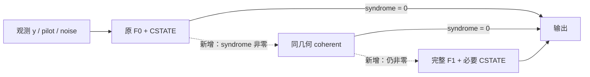

# AFDM 创新潜力探索施工交工单

日期：2026-10-01
独立性：继承主会话模型的独立子代理完成最终文件与证据链审核；公式、源码和结果另有Claude文本审阅。原始工件核验由主执行器实际运行，reviewer未重算raw。指定gpt-6-sol通道404，不能冒称该通道成功。完整结论见同名.review.md。

## 总结

本轮找到并验证了可保留的改进：原 F0+CSTATE 后，仅校验失败才做同几何 coherent，再失败才完整 F1 重启。
在2,048个全新物理仿真观测中，错帧55→29，相对减少47.27%；平均就绪时间0.2769→0.2930秒，增加5.82%。
两个预注册主检验均通过Holm校正。无条件F1参考在同批错42帧、均值0.5691秒。

完整Γ一项、近碰撞细搜索和固定信道非圆参考没有超出更简单强对照的已观察整帧覆盖，因此本轮不继续堆叠。
这是当前四候选族及局部修复的收敛结论，不是“AFDM所有创新已经穷尽”。

## 任务对账

| 原要求 | 已交付 | 证据入口 |
|---|---|---|
| CSV初版计划、随反馈调整并持续执行 | 同一CSV由14行扩至16行，保留初版PLAN和新增两方向 | 同名CSV、PLAN.md |
| 概念审核、优化与文献调研 | 四族问题/机制/最近邻、14个稳定concerns、补充非圆经典近邻 | concept-review.md、idea-blueprint.md、literature/source-map.md |
| 第一性原理与数学推导 | 闭合到TF单步、方向界、簇先验/极限、Gaussian非圆参考 | theory/DERIVATION_PACKAGE.md、theory/NONCIRCULAR_REFERENCE.md |
| 实验与验证 | 11,008次正式完整策略调用；独立新观测与旧暴露开发集分开 | analysis/FRONTIER_AND_NONCIRCULAR.md |
| 得到反馈后调整 | fullΓ→coherent；细簇→强LOCAL/F1；条件F1→2048新帧；旧BLOCK缺口→合法非圆参考 | CSV、各registration与result |
| 论文贡献与剩余边界 | 可写的窄贡献、不能写的主张、未被否定的大问题 | final-analysis.md |
| 独立审核与可恢复交付 | 分阶段独立审阅、原始失败保留、逐工件SHA与Git提交 | reviews/、analysis/FINAL_VERIFICATION.json |

## 施工细节

保留原冻结波形、编码、历史源码与结果，在任务目录新增独立实验。服务器使用原AFDM环境、CPU64、单线程、隐藏GPU、串行计时。
每个完整策略独立读取观测并运行；门控只看syndrome，不使用真值。真值仅在接收完成后进入离线计分。
旧128帧是富集开发集，512帧是初轮新确认，2048帧是另一个独立新确认群体；不混成更大的确认样本。

coherent改变TF反作用的一项；fullΓ不是完整Bayes/AMP。F1是已有前端的条件获取。
新颖性来自原论文物理/协方差问题、合法干预及其机制证据，不能把通用级联或widely-linear表示单独称为新理论。

新增的运行路径：

## 验证情况

数学小例验证圆性极限、先验变换、物理重建与精确Gaussian参考；完整N=1024 smoke验证真实TF/LDPC和矩阵/算子接口。
正式接收机全部完成；逐帧raw、注册顺序、观察/真值绑定、门控、共同科学输出均实际复算。
第一次前沿计分因比较了decoder的实测seconds字段而停止；排除仅该字段并验证其合法性后通过，判决/迭代字段仍严格一致，接收机没有重跑。

未检出错误码字在本批均为0，但零syndrome不等于正确。守卫保护整码字正确性，不保证位错误或信息位事件单调。
强F1对比、事后直接F1组装、时延均值都是明确限定的描述；没有尾时延、所有SNR或所有优化实现的最优性结论。
所用数据均为物理仿真，未运行海试或真实测量信道。

大NPZ保留服务器：
`/data/guoyikun/00inbox/AFDM-channel-estimation/issues/20261001-afdm-innovation-exploration/experiments/`。
本地保存manifest、ledger、每个raw的路径/SHA和审计输出。接收任务已结束，不需持续占用服务。

## 后续边界

可以把独立验证的coherent/条件F1增量及理论边界纳入原论文；本轮未直接改写论文正文，也未宣称某期刊录用概率。
完整非圆联合推断、码相关多模态消费者、未知模型阶数/非平稳信道与海试泛化仍开放。这些需要新的问题定义和推断架构，不能说被本轮阴性实验排除。
详细结论以 final-analysis.md 为入口，数字以相应scored JSON和原始工件为准。

只读复核已有完整工件：SSH连接deinlab，在远端项目根使用原AFDM环境执行 `analysis/score_frontier.py`（完整路径在本任务目录内），期望输出status=pass、calls=8192、错帧55/41/29/42；该操作只读结果，不重新生成观测或运行接收机。完整复现实验入口为experiments/run_frontier.py及冻结registration；旧输出目录拒绝覆写，新重复实验须另立namespace并记录新注册。
