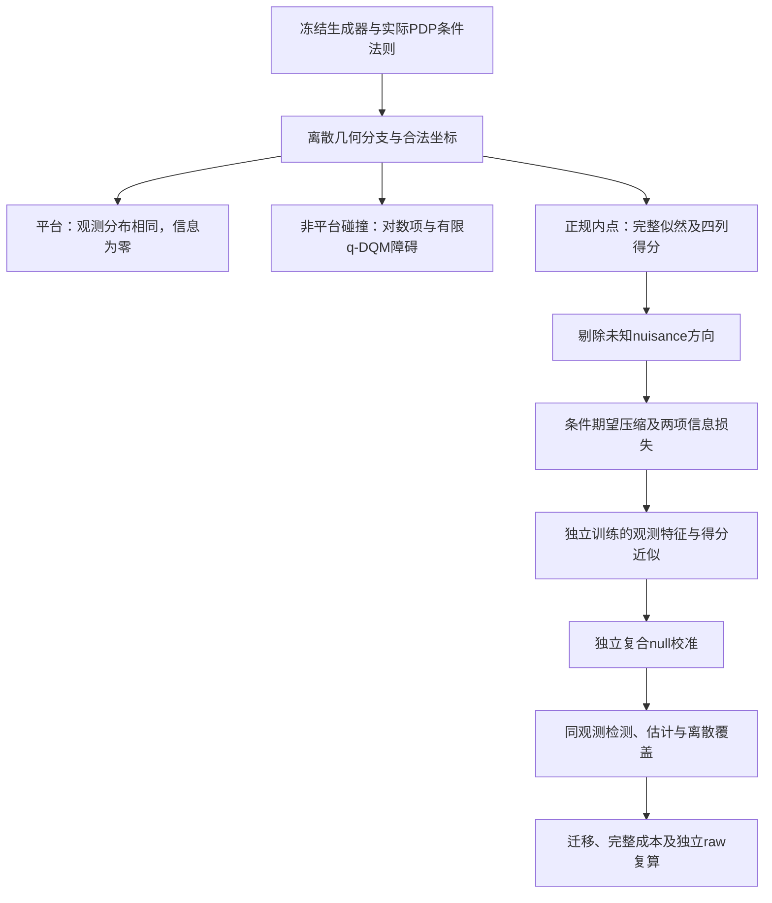

# AFDM 实际先验、有效信息与观测推断：完整探索报告

日期：2026-10-05。任务依据：[批准计划](../../.mission/20261005_10-48-35-afdm-efficient-information/PLAN.md)，逐项状态仅由[任务 CSV](../../.mission/20261005_10-48-35-afdm-efficient-information/20261005_10-48-35-afdm-efficient-information.csv)维护。本轮研究用于判断方向，不晋级论文或生产性能主张。

## 研究裁决

可以继续沿**实际归一化先验的几何分支与非正规信息结构**推进：已有平台定理、非平台碰撞对数项、正规分支数值正有效信息，以及解决近碰撞求积误差的证据。这些是值得保留的数学对象，但文献首创尚未证实。

当前固定四维得分回归则没有证明接近完整似然的检测能力，也没有形成稳定的估计或同精度成本优势。不能把“分布包含信息”“表示充分”“回归误差下降”和“可用算法变好”视为同一件事。本轮完整测试了这条链，各环节的结果如下。

1. **信息存在**：正规双径实际 PDP 边缘分支有数值正证据；指定平台严格零；非平台碰撞一般不能使用控制模型的有限 q-Fisher 理论。
2. **表示保留**：圆对称族的完整相位轨道表示充分；这是精确统计结论。有限线性回归仍可能很差，四锚点迁移也不保留全观测轨道。
3. **可计算近似**：实际先验的功率回归优于当前相位回归；将90维相位特征压到固定4维输出后出现明显信息近似损失。
4. **检测与估计**：控制完整似然在大分离/R=8时检出率上升，当前近似未跟上。实际近邻delta/R≤4设计下，完整数值参考和补充的已知参数oracle均呈低检出率，不能宣称新特征成功；经验oracle不等于严格功效上界。
5. **成本和迁移**：完整相位代表元可降低表示规模，但没有建立与完整似然同精度的低成本推断；迁移虚警和功效按全部条件保留。

## 对象、第一性原理与范围

从冻结生成器的观测分布出发，而非先挑选看起来有用的统计量。实际主模型是P=2、共同 rounded delay=0的条件切片，对真实离散PDP及路径标签边缘化。它不是完整八路径生产总体；固定不等PDP是单独标记的条件oracle。Gaussian双径族仅为控制。

兴趣参数为Doppler半间距delta，nuisance至少包括中心mu、功率tau和噪声sigma²。实际得分原生坐标为 `(delta,mu,logtau,logsigma²)`。只有对称性和合法导数允许时才使用q=delta²；不把换元当作算法改进。

在固定离散分支内，真实PDP来自ceiled exponential increments的有限条件法则，而非任意iid正数。路径标签先赋先验权重，再对共同零delay事件条件化；后验标签权重未必各半。增益经过同一个G0 Gram归一化，必须同时求导几何响应、Gram和归一化，不能冻结隐藏PDP替代可观测边缘模型。

复球面/CP1积分保留实际angular density，对全局相位解析积分为Bessel核，对QPSK完整合法orbit枚举。连续观测由连续潜变量产生，不能从求积节点采样再将其称作真实连续先验。具体推导见[先验理论](../../experiments/afdm_efficient_information/PRIOR_THEORY.md)。

## 几何与碰撞

108个N=4/8/16几何案例和独立dense Gram的最大误差为2.4826e-16。整数中心指定平台的边缘阈值分别约为.08396394、.08917134和.09047462 bin；阈值两侧活跃原子数由1变3。平台上G0观测分布完全相同，不是“估计器暂时学不到”。G1若复用退化G0归一化的增益，可出现无限二阶矩，但这不等于它没有概率分布或所有Fisher均不存在。

在mu=.27/.35、等PDP/条件不等PDP/实际边缘六组非平台碰撞序列中，归一化可观测协方差出现非零 `q log(1/q)` 系数。固定末三点均处同一离散分支，预登记对数斜率相对误差约1.31e-6至2.64e-6。较大delta的三处PDP跨分支保留；末点直接比值的慢收敛检查六组均未通过，不能把斜率通过替代其他失败判据。

非零二阶矩对数项与统一四阶矩界，通过Hellinger Cauchy–Schwarz排除该分支有限q-DQM。它**没有**给出统一KL阶数、有效信息渐近常数或重复样本分辨率；不能把控制模型的重复率结论直接移植过来。

## 实际完整得分与数值证据

每个原始案例256条独立观测，前128拟合nuisance投影，后128验证。正权product12×24、24×48及独立Sobol64×128加密，另检验三个导数步长和直接logpdf差分。以下是保存的heldout残差二阶矩及批次SE，并非严格总体有效Fisher证书。

| 实际先验案例 | 结果 | 判定边界 |
|---|---|---|
| 正规G0实际PDP边缘，delta=.2 | 有效delta信息约.26645，SE .04527 | 数值加密通过且大于4 SE，保留数值正证据 |
| 正规G1实际PDP边缘 | 约4.26849，SE .78841 | 在该正定分支数值正，不外推退化G1 |
| G0固定不等PDP条件模型 | 约.19821，SE .02311 | 条件oracle数值正，与边缘结果分列 |
| G0等PDP条件模型 | 约.27061，SE .07573 | 数值收敛，但未过4 SE正性判据 |
| G0实际边缘，delta=.035 | 原规则不收敛；同数据谱坐标加密后约9.68462，SE 8.81713 | 积分已收敛，有限样本正性仍未定 |
| 指定G0平台 | 精确0 | delta得分逐项为0，不用正数jitter制造信息 |

近碰撞加密的固定公开谱基将狭窄归一化区域移至端点，采用 `t=1-(1-s)^4` 的正Jacobian。谱基在参数stencil中固定，实际PDP密度在原路径坐标评价，因此没有漏掉移动坐标或PDP导数。共18,944个使用节点，另32个未使用初始化节点；没有新增观测。加密三组规则比较、所有导数及mass检查通过，独立规则有效信息相对差约5.07e-5。原v1失败、旧新delta-score约11.15%的差异完整保留。

这次修复把“积分算不准”与“样本不足以确定正性”分开。后者没有因更准确的积分而消失。完整数值、费用、分支和哈希见[先验结果](PRIOR_RESULTS.md)。

## 压缩信息的正确数学关系

在合法L²得分空间内，令完整有效得分 `e=s_delta-P_H s_delta`，条件期望压缩 `C=E[·|Phi]`，压缩nuisance空间 `H_Phi=span(C s_eta)`。则

\[
I_{eff}-I_{eff}^{Phi}=\|e-Ce\|^2+\|P_{H_{Phi}}Ce\|^2.
\]

压缩后必须重新处理nuisance混淆。四状态正规指数族给出完整信息.5、错误“先硬化再取方差”结果.25、正确压缩有效信息0的精确反例。若**精确**e已Phi可测，则局部有效信息可无损保留；这一特殊正结论与一般不交换并不冲突。

特征线性矩信息 `J^T Sigma^+ J` 的Schur补，是总体线性空间下界；有限样本plug-in不是认证下界。得分回归MSE则同时包含压缩丢失和有限函数类逼近误差，不能直接除以一个Fisher数字称为保留率。

圆对称族下，`yy^H`与完整规范 `z=y conj(y_j)/|y_j|`（最大模锚点、固定ties、零向量单列）编码同一轨道，均充分。z的构造是O(N)，外积是O(N²)。充分性不保证有限回归有效，也不适用于携带相干参数的非圆族。完整证明、近似误差条件界与退化情形见[得分理论](../../experiments/afdm_efficient_information/SCORE_THEORY.md)。

## 特征、未知nuisance、检测和估计

嵌套能量/旧T/功率交叉/相位结构均只接收观测和公开设计。训练、选ridge验证和最终测试分开；全轨道gauge是单独非嵌套对照。控制研究10,240条、实际特征研究1,280条新观测。实际教师全部1,280条通过冻结加密检查。

实际特征中，powers有效目标MSE约.09494，phase约.14467；phase输入线性信息plug-in约.10811，固定4维输出约.01634。powers输出约.06786。该比较显示当前相位线性回归丢失了可利用结构，不能因为相位输入充分就宣称4维模型无损。Gaussian教师跨先验/基点/坐标失配单独保留；固定公开点坐标对齐不是跨模型精确得分变换。详见[控制特征](FEATURE_CONTROL_RESULTS.md)和[实际特征](FEATURE_ACTUAL_RESULTS.md)。

未知nuisance在同一公开网格profile，校准取各null条件次序统计阈值的最大值。保证在独立校准和未来观测上取边际，且只适用于注册有限网格；不保证固定某次阈值的条件错误率，不使用Wilks。控制60点、R=1/8；实际16点、R=1/4，每个实际坐标仅两个值。

控制R=8、q=.16的12 nuisance点平均检出率：完整似然.28385、phase .05208、score4 .00781。真实二阶Gaussian在控制族没有q/mu信息，其随机硬币拒绝率不能理解为几何识别。实际先验二阶矩随几何变化，采用 `diag(diag(tau E[vv^H]))+sigma²I`，没有将控制族的无信息结论套用过来。

实际R=4完整参考备择拒绝2/512，actual_score4为0/512。所有实际方法的delta投影hull都覆盖完整注册区间.06，高覆盖并不代表精确估计。边界率恒1由两点轴设计造成，不是算法数值崩溃；对连续参数覆盖没有保证。全部720个控制和256个实际条件行，包括逐点虚警、Wilson区间、参数误差、bias、集合覆盖和失败，见[完整推断报告](INFERENCE_RESULTS.md)。

完整数值参考在实际98,304个观测/候选对的order12/24比较全部合格，预定512对order24/48也全部合格；两阶候选选择无分歧。这排除了本设计中可见的参考积分不稳定，却没有证明某个因素单独导致低功效。两delta很近、R小和保守复合校准的作用尚未分离，结论是当前设计证据不足。

### 已知参数参考与候选多解补充

第一次独立终审发现原计划缺少已知nuisance参考和逐组多解统计。补充读取既有完整likelihood、校准及目标矩阵，零新增观测或积分规则，覆盖112个null/alt/R对、1,408行判决配对、152个已知nuisance估计条件、976行估计配对和976行歧义统计，另检查9个冻结moment评分准则。完整结果及逐行JSON见[oracle与多解结果](ORACLE_IDENTIFIABILITY_RESULTS.md)。

实际R=4的已知nuisance、已知备择oracle检出19/512个备择组，R=1为20/512；逐条件虚警与Wilson区间完整保留。原未知nuisance完整参考在R=4为2/512，四维得分为0/512。oracle同时改变已知信息和校准问题，不能把差额单独归因于nuisance；跨R复用观测，不能把合并行数当独立样本。理想真密度、相同真实size下的Neyman–Pearson最优性是理论上界；本轮有限校准、数值密度的经验结果不是认证上界，不能据此宣称其他算法绝无改进空间。

控制old_T/powers在全部条件/R的3,840个组引用中，预登记机器容差下的联合多解均为3,840/3,840，而兴趣参数多解均为0；严格浮点并列分别为3,807/3,840和3,383/3,840。已有解析结论表明它们的功率特征分布不含中心mu信息。控制二阶Gaussian工作族的q/mu均无信息。实际各方法在机器容差下未出现并列最优，但这不证明总体可辨识，更不改变其宽置信集合和弱分辨能力。数值近邻不具有传递性，未合并成所谓等价类；结构不可辨识、冻结准则等价和有限样本并列分别报告。原始首索引选择及所有失败、误差完整保留。

## 迁移、费用与创新边界

迁移使用预先指定的控制point1 phase模型，N=4/16/64、8个先验/输入/噪声情形、7,680条新观测。pilot、非均匀、相关重复输入均有合法模型；完整原始输入和噪声可回放。N>4的四锚点明确为有损压缩，不能借全轨道定理声称充分。全部48组阈值/性能结果、72个几何诊断和表示成本均保留。

8个科学阶段累计82,176条新独立观测，注册wall上限合计6,120秒，实际阶段wall合计340.0484秒。另计cost_v1和独立AUDIT后，共10个登记阶段、预约7,080秒，均在10,800秒总上限内完成；零新观测reader没有重复计入样本量。完整迁移表与表示成本见[迁移费用结果](TRANSFER_COST_RESULTS.md)，审计及累计费用见[独立复算结果](AUDIT_RESULTS.md)。原始大数组保存在本地并由提交的attempt哈希绑定；源码、注册、环境和摘要纳入Git。失败的transfer_v1在创建登记/生成观测前拒绝，修复虚拟PyTorch模块路径后以transfer_v2运行；没有覆盖失败或重采样挑选。

终审补充reader与独立复算后，最终累计12个登记阶段、82,176条新观测、7,440预约秒；attempt实测wall合计1,108.486652秒、CPU合计1,102.396381秒，结果约1.273GB。最大单进程峰值RSS为2,556,035,072 bytes，峰值不相加，2GB约束针对输出。补充两阶段未增加观测或科学节点，旧10阶段费用保留。精确可重建总账见[资源记录](../../.mission/20261005_10-48-35-afdm-efficient-information/FINAL_RESOURCE_TOTALS.json)。

费用分清候选/教师/训练/校准/完整推断以及嵌套子块。控制likelihood的Cholesky计数并不包含额外 `solve(cov,I)`：控制推断有15,360个Cholesky矩阵及15,360个通用solve矩阵，两者不能合成一个含糊计数。实测whole-stage wall原本已包含两者。全相位代表元和外积可以比较同一表示对象的费用；学习近似与完整似然尚不同精度，因此不报告虚构摊销优势。

score compression、nuisance hardening、SALLY/SALLINO回归、GMM和相位规范都不是本轮首创。四篇新增一手正文及沿用的高阶统计/AFDM资料逐式核对见[文献边界](LITERATURE.md)。平台/对数非正规项/实际PDP条件法则及谱坐标求积是可继续检查的模型特定贡献；专门对数渐近近邻尚未系统排查，不能称首创。旧N1024与论文主张不因本轮小模型结果升级。

## 十二目标对账与独立审查

第二轮独立复审已逐条关闭原两项缺口，覆盖12/12目标，未发现新的交付缺口。研究验收通过包含负结果和明确未定，不等于创新性或算法优势获证。[独立审查记录](../../.mission/20261005_10-48-35-afdm-efficient-information/reviews/REVIEW-02.md)与[完整交工单](../../.mission/20261005_10-48-35-afdm-efficient-information/20261005_10-48-35-afdm-efficient-information.handoff.md)保留全部边界。

| 目标 | 已交付证据 | 科学结论或限制 |
|---|---|---|
| 冻结范围、预算、旧证据 | run_contract、protected_baseline、各stage registration/attempt | 82,176新观测；4,307个旧文件哈希独立核验不变 |
| 实际先验几何与合法坐标 | PRIOR_THEORY、108几何、6碰撞序列 | 平台、正规区、非正规q分开 |
| 条件/边缘完整得分 | 6信息案例及同数据refinement | 部分数值正、平台零、近碰撞统计未定 |
| 压缩有效信息理论 | SCORE_THEORY、四状态精确反例 | 两项损失，不交换投影；精确有效得分特例无损 |
| 观测特征与退化处理 | energy/old_T/powers/phase/gauge源码与测试 | 全轨道充分；有限回归与锚点压缩另判 |
| 独立得分逼近与失配 | control/actual feature raw与报告 | 不把plug-in当Fisher证书；无稳定相位回归优势 |
| 未知nuisance拟合/校准 | INFERENCE、完整候选/calibration矩阵、已知nuisance补充参考 | 无真值nuisance或潜在PDP部署输入；oracle明确单列 |
| 统一虚警口径检测 | 976逐条件行、CI、参考加密及112个oracle对照 | 当前score4未接近完整参考；经验oracle功效仍低但不是认证上界 |
| 参数估计与覆盖 | 相同候选域误差/bias/集合；976行多解与152个已知nuisance估计条件 | 无换元收益；物理不可辨识/准则等价/样本多解分开；有限网格覆盖不推连续覆盖 |
| 迁移及完整成本 | transfer_v2、cost_v1及独立复算 | 无同质量推断优势；保留全部失配条件 |
| 逐命题近邻 | LITERATURE、来源正文及失败检索记录 | 已知方法排除首创；特定渐近近邻尚未穷尽 |
| 中文报告、raw审计与独立交工 | 本报告；AUDIT_RESULTS；最终review/handoff由REVIEW行记录 | 原始数据33,278检查通过；逐行终态以CSV为准 |

原独立raw审计最大数值差约6.112e-10，0检查失败；实际推断的全量统计与256帧分层积分范围分列，未冒称全密度矩阵独立积分。补充独立复算另有126,429项检查，0失败，最大绝对差1.4211e-14；所有新增统计全量复算，4,307旧文件及绑定工件哈希一致，没有重新积分。详见[补充审计](SUPPLEMENT_AUDIT_RESULTS.md)。原72项及11个子测试之外，新增12项reader与8项独立reader测试；没有配置应用build或独立type-check目标。审计通过不改变平台零信息、近碰撞统计未定和当前检测/估计无优势的研究裁决。

## 复现入口

统一使用 `/tmp/afdm-shared-channel-env/bin/python`，设置OMP/OPENBLAS/MKL/VECLIB_MAXIMUM/NUMEXPR线程数为1、CUDA_VISIBLE_DEVICES为空。所有科学入口在源码提交后串行运行。已存在的stage名拒绝覆盖；重跑会占新预算，当前无需重跑。

| 模块（`python -m experiments.afdm_efficient_information.<module>`） | 参数与已完成stage |
|---|---|
| features_study | `--stage feature_control_v1` |
| prior_study | `--mode geometry --stage prior_geometry_v1`；`--mode information --stage prior_information_v1` |
| features_actual | `--stage feature_actual_v1` |
| inference_control / inference_actual | `--stage inference_control_v1` / `--stage inference_actual_v1` |
| prior_refinement | `--stage prior_refinement_v1`，只复用已绑定旧256条Y |
| transfer_study | `--stage transfer_v2 --model-path results/afdm_efficient_information/feature_control_v1/model_1_phase.npz` |
| transfer_study | `--mode cost --stage cost_v1` |
| audit | `--stage audit_v1`，零新观测、复用既有规则的独立reader |
| oracle_identifiability | `--stage oracle_identifiability_v1`，读取冻结似然与目标矩阵 |
| supplement_audit | `--stage supplement_audit_v1 --input-stage oracle_identifiability_v1`，全量补充统计复算、零新积分 |

逐条完整命令、种子、配置、Python环境、执行源码快照和raw SHA见各stage的registration/attempt，不以当前工作树替代历史执行源码。父研究保持开放；本轮没有新增生产receiver、decoder、确认流、远端/GPU或付费调用。
