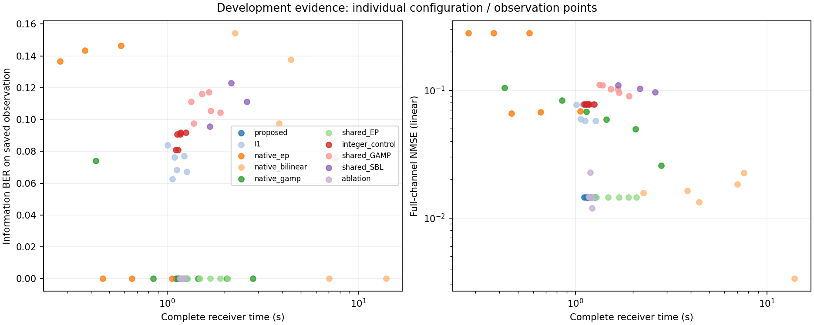
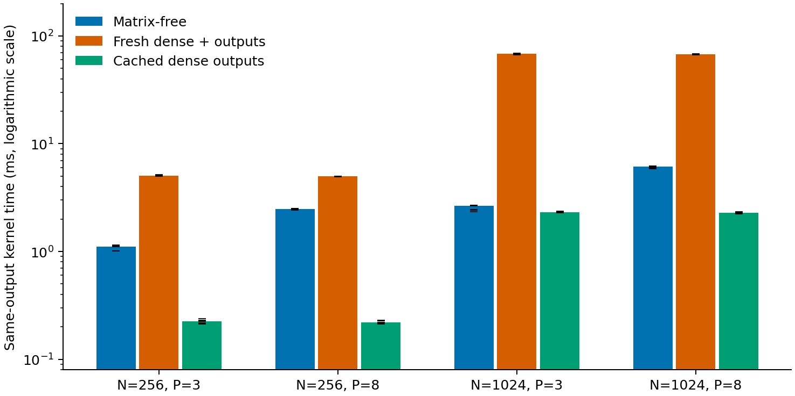

# SP-AFDM minimal staged development — 2026-09-21

**Completed: 260 Stage-1 + 256 Stage-2 calls on 84 fresh independent observations. Stop this campaign: the predeclared further-development heuristic is not met. No full grid, retuning, new receiver module, confirmation or selection lock.**

Frozen campaign source: `2f69125c`; unchanged receiver: `31d5ec0d`. [Prospective plan](../../.trellis/tasks/09-21-sp-afdm-frozen-evidence/staged-plan.md). Scope: N=1024, LDPC(2048,1024), rho=0.5, eight physical paths, only 6/8 dB. Stage 1 has 10 paired frames per cell; Stage 2 has 32 different paired frames per cell. Absolute frames are 100000–100009 and 200000–200031. Old engineering observations are not pooled; adaptive stages are reported separately. The 516 receiver calls are **not** 516 independent radio observations.

## Six requested answers

1. **Survivors:** `I1_BP8_r1`, `P_M24_I20`, structured EP `N_ep_2_r2`, and coded PBiGaBP `N_bilinear_8_r2`. Stage 1 eliminated both GAMP budgets, SBL1, mean-only and the cheaper PBiGaBP budget under the registered observed-dominance rules. Scalar Gamma and M16/I8 lost within the proposed family; EP8 lost the family-budget comparison. These latter exclusions are budget selection, not proof of inferiority. All elimination reasons remain in the [gate](staged_campaign_20260921/receipts/stage1_complete/stage1_gate.json).
2. **Signal for further development:** a small accuracy signal exists, but not enough under the frozen complete-cost rule. In independent Stage 2, proposed versus EP has **2 rescues / 0 harms at 6 dB**, **1 rescue / 0 harms at 8 dB**. Neither reaches four net rescues, and proposed costs **2.27× / 2.47×** EP, above the 1.2× allowance. It also fails the cheaper-at-comparable-error alternative; the I1 guard passes. At 8 dB, EP already reduces the frame-error count from I1's ten to one; proposed reduces it by one more. **Stop/defer this direction under the present design; no complete-cost superiority or confirmation-ready claim.** This is an exploratory allocation decision, not proof of population inferiority.
3. **Informative regime:** **6 dB** distinguishes the unrestricted accuracy/cost tradeoff: I1 and EP fail 32/32, proposed 30/32, PBiGaBP 24/32. It remains a high-FER regime. **8 dB** mainly distinguishes cost and improvement over I1: I1 10/32, EP 1/32, proposed/PBiGaBP 0/32. Zero observed errors at n=32 does not establish zero population FER. Neither cell provides a well-resolved low-FER confirmation point; the transition is only bracketed between 6 and 8 dB. No ad hoc SNR search was run.
4. **Gamma simplification:** mean-only is not supported as the simplification: it has worse screening errors/NMSE and was observed dominated by EP. **Scalar Gamma remains a credible simplification candidate, but equivalence is unproven.** Matched M24/I20 scalar/full have exactly the same Stage-1 FER (9/10 and 1/10); full only reduces information errors from 846 to 836 across 20,480 bits. Median NMSE scalar/full is 0.025255/0.025243 at 6 dB and 0.013299/0.013294 at 8 dB. Full-Gamma median off-diagonal Frobenius ratios are 0.000787 and 0.001218. These support questioning the necessity of off-diagonal Gamma, not a universal equivalence claim. The frozen rank advances full M24/I20; no scalar retuning or post-selection substitution occurred. M16/I8 was faster but added one screening frame error at 8 dB.
5. **External rivals to retain if future confirmation is authorized:** **structured EP `N_ep_2_r2` and coded PBiGaBP `N_bilinear_8_r2`**. EP is the practical low-cost rival; PBiGaBP is the stronger unrestricted-accuracy rival at 6 dB, with much higher latency. No third family qualifies after the registered exclusions. These are existing frozen implementations, not a claim to have exhaustively optimized the literature. The E-JSG-like actual-H control remains old engineering evidence only; no fresh E-JSG reproduction is claimed.
6. **Next-stage budget:** recommended additional compute/storage **now: zero**, because the continuation gate failed. For budgeting only, reusing the same four survivors with 32 new frames would cost about **8.9 receiver-minutes / 10–12 process-minutes / 5–7 MiB per cell** (128 calls), or **17.8 receiver-minutes / 20–25 process-minutes / 9–12 MiB for both cells** (256 calls), under the same audit retention. Estimates use observed Stage-2 costs, not a confirmation sample-size calculation. Nothing further was launched.

## Independent Stage 2 results

Primary deadlines stay fixed from Stage 1: **1.636605 s at 6 dB**, **1.607883 s at 8 dB** (1.5× Stage-1 I1_BP12_r0 median complete time). The deadline outcome is the last completed decision available by that deadline. Each method pays its complete online work; offline truth scoring and storage are separate.

| SNR dB | Configuration | Unrestricted FE | Deadline FE | Information-bit errors | Median complete s | Median full-channel NMSE |
|---:|---|---:|---:|---:|---:|---:|
| 6 | I1_BP8_r1 | 32/32 | 32/32 | 5038/32768 | 1.044 | 0.134912 |
| 6 | P_M24_I20 | 30/32 | 30/32 | 3195/32768 | 1.213 | 0.027517 |
| 6 | N_ep_2_r2 | 32/32 | 32/32 | 3847/32768 | 0.535 | 0.075525 |
| 6 | N_bilinear_8_r2 | 24/32 | 32/32 | 2209/32768 | 13.773 | 0.024926 |
| 8 | I1_BP8_r1 | 10/32 | 10/32 | 859/32768 | 1.048 | 0.057122 |
| 8 | P_M24_I20 | 0/32 | 0/32 | 0/32768 | 1.219 | 0.013716 |
| 8 | N_ep_2_r2 | 1/32 | 1/32 | 79/32768 | 0.494 | 0.055827 |
| 8 | N_bilinear_8_r2 | 0/32 | 32/32 | 0/32768 | 13.841 | 0.004131 |

PBiGaBP's 24/32 and 0/32 unrestricted errors must not be presented as timely decisions: it misses all 32 deadlines in each cell. Proposed information BER at 6 dB is 0.09750 versus EP 0.11740, a descriptive 16.95% relative reduction at more than twice the cost; at 8 dB it is 0 versus EP 0.002411. Frame-level dependence prevents treating bits as independent statistical replicates. Selection-used Stage 1 is not pooled into this assessment.

[Validated Stage-2 summary and heuristic](staged_campaign_20260921/receipts/stage2_complete/stage2_summary.json) · [Frame ledger](staged_campaign_20260921/receipts/stage2_complete/ledger.jsonl) · [FER/BER, code errors, NMSE mean/SD, time mean/SD and relative I1 deltas](staged_campaign_20260921/analysis/stage2_cells.csv). Secondary 1×/1.25×/2× deadline outcomes remain in each stage summary; no deadline was chosen after Stage 2.

## Actual compute, storage and integrity

- **516 measured calls**, 94.53% fewer than the rejected 9,440-call grid. There were also 34 separately recorded phase-zero warmup calls across audit/resume invocations; they are not scientific samples.
- Complete receiver time: **687.055 s + 1065.111 s = 1752.166 s (29.20 min, 0.487 h)**. Numerical-process wall time across the four audit/continuation invocations: **1995 s (33.25 min)**, including setup/warmups/scoring/storage; excludes orchestration, transfer and separate offline verification. Warmups total 103.127 s; measured frame generation 29.292 s; scoring/storage 80.481 s. The completion.json process timer describes only its final invocation, so it must not replace the summed command receipts.
- Stage run evidence: **30,475,018 + 9,065,668 = 39,540,686 bytes (37.71 MiB)**, of which 35,540,986 bytes are heavy audit data. This excludes small campaign scripts/command receipts. Heavy retention covers 34 predeclared arm/observation pairs on four independent audit observations; no numerical exceptions occurred. All 516 attempts retain compact bits, counts, seeds, configs, hashes, timing, memory and diagnostics. Ordinary frame errors did not trigger large-array retention.
- Maximum whole-process RSS: **1,174,332 KiB (1.12 GiB)**. Per-call RSS/HWM is saved but shared-process high water is not an isolated per-arm peak. The prior exact-configuration PBiGaBP probe remains available in historical evidence; no extra memory campaign was run.
- **9/9 focused synthetic contract tests passed** before new observations. Both complete-stage bit/identity recounts passed (260 and 256); heavy input/truth/decoded crosschecks and independent full-H NMSE/hash recounts passed **26/26 and 8/8**. Non-audit I1 NMSE is producer-scored with H hashes, not independently reconstructible from the compact record; fitted physical-path estimates retain their small reconstructible parameters. Do not claim every saved NMSE received a full-matrix independent audit.
- Single CPU numerical process at a time, GPU disabled, BLAS/Torch threads fixed to one, no installs; all remote writes under `/data/guoyikun/`. Remote run roots: `deinlab:/data/guoyikun/00inbox/AFDM-channel-estimation/results/sp_afdm_frozen/staged_campaign_20260921/{stage1_run,stage2_run}`. Large audit arrays stay remote; compact evidence and command receipts are returned locally.

[Stage-1 audit receipt](staged_campaign_20260921/receipts/stage1_audit/stage1_audit_recount.json) · [Stage-2 audit receipt](staged_campaign_20260921/receipts/stage2_audit/stage2_audit_recount.json) · [Execution receipts](staged_campaign_20260921/receipts/). [Remote file hashes and byte inventory](staged_campaign_20260921/receipts/remote_inventory.json) record 652 files; all 610 returned compact/metadata files match their remote hashes, while 42 heavy audit files remain remote. [Server clearance](staged_campaign_20260921/receipts/remote_clearance.txt) at 2026-09-21 08:47:46 UTC confirms no related process or `g_` session and all four numerical invocations exited 0. Scientific STATE is not promoted; this is a bounded exploratory delivery, with no accepted superiority claim.

## Stage 1 triage

| Configuration | Unrestricted FE, 6 dB | Unrestricted FE, 8 dB | Deadline FE, 6; 8 dB | Median complete seconds, 6; 8 dB |
|---|---:|---:|---:|---:|
| I1_BP12_r0 | 10/10 | 6/10 | 10/10; 6/10 | 1.091; 1.072 |
| I1_BP8_r1 | 10/10 | 5/10 | 10/10; 5/10 | 1.053; 1.023 |
| ABL_mean | 10/10 | 2/10 | 10/10; 2/10 | 1.210; 1.185 |
| ABL_scalar | 9/10 | 1/10 | 9/10; 1/10 | 1.223; 1.194 |
| P_M24_I20 | 9/10 | 1/10 | 9/10; 1/10 | 1.218; 1.192 |
| P_M16_I8 | 9/10 | 2/10 | 9/10; 2/10 | 1.132; 1.107 |
| N_ep_2_r2 | 10/10 | 0/10 | 10/10; 0/10 | 0.477; 0.472 |
| N_ep_8_r2 | 10/10 | 0/10 | 10/10; 1/10 | 1.116; 1.134 |
| N_gamp_g1_i30_r2 | 10/10 | 6/10 | 10/10; 6/10 | 0.838; 0.837 |
| N_gamp_g4_i40_r3 | 9/10 | 2/10 | 10/10; 7/10 | 2.765; 2.731 |
| S_SBL1 | 10/10 | 10/10 | 10/10; 10/10 | 1.701; 1.677 |
| N_bilinear_8_r1 | 10/10 | 0/10 | 10/10; 10/10 | 6.888; 7.144 |
| N_bilinear_8_r2 | 8/10 | 0/10 | 10/10; 10/10 | 13.579; 13.380 |

The frozen gate selected `I1_BP8_r1`, `P_M24_I20`, `N_ep_2_r2` and `N_bilinear_8_r2`, on both cells. Stage 2 used 32 new frames per cell (256 calls). In Stage 1 the proposed configuration and EP each rescue one deadline frame in a different cell; neither establishes a general advantage. PBiGaBP has the best unrestricted error counts but exceeds the deadline.

Mean-only was observed dominated by EP. Matched scalar/full Gamma have identical frame-error counts (9/10 at 6 dB, 1/10 at 8 dB); full reduces total information-bit errors from 846 to 836 across 20,480 bits. This small screening difference does not establish that full Gamma is necessary or that scalar is equivalent; only the predeclared winner advances.

[Validated Stage-1 summary](staged_campaign_20260921/receipts/stage1_complete/stage1_summary.json) · [Selection and all elimination reasons](staged_campaign_20260921/receipts/stage1_complete/stage1_gate.json) · [Frame ledger](staged_campaign_20260921/receipts/stage1_complete/ledger.jsonl).

[Cell-level FER/BER, NMSE mean/SD and costs](staged_campaign_20260921/analysis/stage1_cells.csv) · [Matched Gamma diagnostics](staged_campaign_20260921/receipts/stage1_complete/gamma_summary.json).

---

## Historical engineering evidence — prior delivery, 2026-09-21

**Status: 59/59 registered configurations completed on one shared development observation; offline recount passed. This session delivers small-scale results only, as requested. No full development, selection lock or confirmation campaign.**

Final server check at 2026-09-21 05:13:41 UTC found no related numerical process or `g_` tmux session. All task files remain under `/data/guoyikun/`.

## Current single-observation result

Cell 2, 7 dB, frame 0; N=1024, LDPC(2048,1024). All 59 attempts completed with no numerical failure or fallback; 30 configurations returned zero information-bit errors. Run identity: `5517905f8cea2ca43239cbd2aaa18622c736d7cb8fae54e45d3d14d55f2e99d9`.

| Configuration | Information errors / 1024 | Decoded code errors / 2048 | Complete seconds | Full-channel NMSE |
|---|---:|---:|---:|---:|
| I1_BP12_r0 | 78 | 155 | 1.095 | 0.077539 |
| P_M16_I8 | 0 | 0 | 1.111 | 0.014556 |
| P_M24_I20 | 0 | 0 | 1.203 | 0.014556 |
| N_ep_2_r2 | 0 | 0 | 0.463 | 0.065712 |
| S_EP2 | 0 | 0 | 1.184 | 0.014556 |
| ABL_scalar | 0 | 0 | 1.167 | 0.014584 |

On this observation, native EP achieves the same zero decoded errors faster than every proposed configuration. The proposed refit improves channel NMSE relative to I1, but improved NMSE does not establish a decoding/cost advantage. Scalar Gamma also has zero errors and nearly the same NMSE as full Gamma. **No complete-cost advantage or full-Gamma performance headline is supported by this screen.** This is a descriptive observation, not evidence of population superiority/inferiority. The fastest arm is identified retrospectively, not selected for confirmation.

[All 59 frame metrics](cost_screen_20260921/analysis_v1/frame_metrics.csv) · [Recount and provenance summary](cost_screen_20260921/analysis_v1/summary.json) · [Offline analysis script](development_report.py)

Total process wall time was 228 s (including warmups/setup/storage), with 107.210 s summed receiver time across the 59 measured attempts. Whole-process peak RSS was 1,167,728 KiB; this is not isolated per-arm memory. Raw output: 68,831,781 bytes in 64 files. The one-observation extrapolation for the original 9440-call development is 4.765 receiver-hours and conservatively 10.257 GiB raw storage; allowing setup/storage gives roughly 5–6 hours. The user explicitly chose small-scale delivery, so that campaign was not launched.

Raw results remain at `deinlab:/data/guoyikun/00inbox/AFDM-channel-estimation/results/sp_afdm_frozen/cost_screen_20260921/cost_screen_run`. The analysis inventory records exact paths, sizes and SHA-256. The SSH interruption was a network-proxy issue; analysis resumed after connectivity returned, without repeating the screen.

## Independent process memory and plots

Ten representative registered configurations each ran in a fresh process (warmup plus one measured call), all exit 0. Whole-process peak RSS includes interpreter, code/model setup and native-library allocations; it is not an exact incremental online peak. Native arms construct no unused I1 model and read observed input only, not truth. These repetitions are memory probes, not additional independent radio samples.

| Configuration | Process peak RSS (MiB) |
|---|---:|
| I1_BP20_r1 | 686.5 |
| P_M32_I20 | 710.2 |
| N_ep_8_r2 | 607.7 |
| N_bilinear_8_r2 | 1102.7 |
| N_gamp_g2_i60_r3 | 615.0 |
| S_EP20 | 705.3 |
| S_GAMP2_60 | 726.9 |
| S_SBL3 | 713.5 |
| C_M40_I20 | 694.0 |
| ABL_scalar | 727.4 |

[Memory CSV and measurement setup](cost_screen_20260921/memory/memory_summary.csv) · [Per-arm command receipts](cost_screen_20260921/memory/)

[Vector figure](cost_screen_20260921/analysis_v1/cost_error.pdf) · [All-arm deadline outcomes](cost_screen_20260921/analysis_v1/deadline_observation.pdf) · [Deadline CSV](cost_screen_20260921/analysis_v1/deadline_errors.csv) · [Paired counts versus I1](cost_screen_20260921/analysis_v1/paired_vs_I1.csv) · [Offline support/residual diagnostics](cost_screen_20260921/analysis_v1/offline_diagnostics.json)

## Recovery and provenance

Resumed the approved task from Codex `01a0c1cc-85f8-74a0-be5e-e2abd8be9dd5` in the correct AFDM project. Original-source boundary commit: `70dd0077`. All 279 delivered files were checked against the ZIP; 278 SHA256SUMS entries and the manifest itself match. New remote project data are under `/data/guoyikun/00inbox/AFDM-channel-estimation/`. Original imported results remain historical evidence. The old remote home directory was also moved intact under `/data` (279 hashes rechecked); see [relocation receipt](remote_home_relocation.json).

## Fresh original qualification

- Eight original commands passed: core (134 comparisons), baselines (22), bilinear, cache, fallback, integration, native interface, same-output kernel benchmark.
- Independent saved-decision recount passed all 104 historical decisions. This validates saved counts; it does not create new independent radio trials.
- Fresh native engineering smoke complete times: GAMP 0.709 s, EP 0.541 s, bilinear 2.231 s. Reduced iteration settings; not an equal-cost performance comparison.
- Highest observed whole-test process RSS: 1,134,092 KiB (native smoke). This includes interpreter/setup/multiple cases; it is not isolated per-arm online memory.
- Full logs, argv, deadlines, exit codes and process metrics: [qualification evidence](qualification_original_20260921/).

## Fresh same-output kernel benchmark

| N | Paths | Matrix-free ms | Fresh dense + outputs ms | Cached dense outputs ms |
|---:|---:|---:|---:|---:|
| 256 | 3 | 1.109 | 5.061 | 0.225 |
| 256 | 8 | 2.489 | 4.963 | 0.220 |
| 1024 | 3 | 2.651 | 68.377 | 2.313 |
| 1024 | 8 | 6.132 | 67.843 | 2.281 |

Seven interleaved timings per fixed fixture; all required outputs agree (maximum discrepancy 2.49e-12). Cached dense is faster on these fixtures. Matrix-free saves fresh construction/storage in this stage; these measurements do not establish complete-receiver superiority.

[CSV](qualification_report_20260921/same_output_kernel.csv) · [vector PDF](qualification_report_20260921/same_output_kernel.pdf) · [script](qualification_report.py)

## Corrected engineering smoke (intermediate v3)

Three arms ran on the same development cell 2/frame 0 (7 dB). This is one physical observation, not three independent trials. Saved-array recount verified all bits and exact I1 COO/dense canaries; 11 sequential regressions passed. Run/source identity and all eight returned file hashes are in [v3 recount](corrected_pipeline_20260921/driver_smoke_v3_recount.json).

| Arm | Information errors / 1024 | Decoded code errors / 2048 | Complete receiver seconds |
|---|---:|---:|---:|
| I1_BP12_r0 | 78 | 155 | 1.070 |
| P_M24_I20 | 0 | 0 | 1.197 |
| N_ep_2_r1 | 140 | 287 | 0.277 |

The whole smoke process took 10.53 s and peaked at 780,296 KiB RSS, including setup and warmups. These are engineering observations, not a family comparison or a population BER/FER estimate. The first smoke launcher failed before any frame because Torch inter-op threads were set twice; the corrected launcher leaves `build()` as the single binding authority. Failed logs are preserved.

## Final corrected source qualification

Corrected source boundary: `31d5ec0d`. The final reviewed snapshot fixes stage/round/event time validation, includes failed-attempt costs in seal/analysis, saves explicit frame seeds, and records both existing decoder calls in `ABL_fresh_APP`. The four-arm real smoke passed in 13.01 s with 780,312 KiB whole-process RSS. Its saved-array recount and fresh-APP decoder-cost check passed; the two decoder costs sum exactly to the ledger total. Final run identity: `b665510819ae7464320450681458c29de98fd0158239c9f5d13610bf27cf52df`.

[Final smoke and validation receipts](reviewed_pipeline_20260921/) · [Independent review](../../.trellis/tasks/09-21-sp-afdm-frozen-evidence/research/independent-review.md)

The final four-arm smoke reuses development cell 2/frame 0 from v3. The 59-arm screen uses that same registered observation; these runs must not be counted as independent radio trials. Intermediate evidence remains preserved.

## Historical scope

The single-observation screen above remains engineering evidence only. The new staged campaign at the top supersedes its earlier exhaustive-development roadmap. The original 59 × 5 × 32 grid is not required or authorized; no final confirmation or accepted scientific STATE promotion has occurred.
